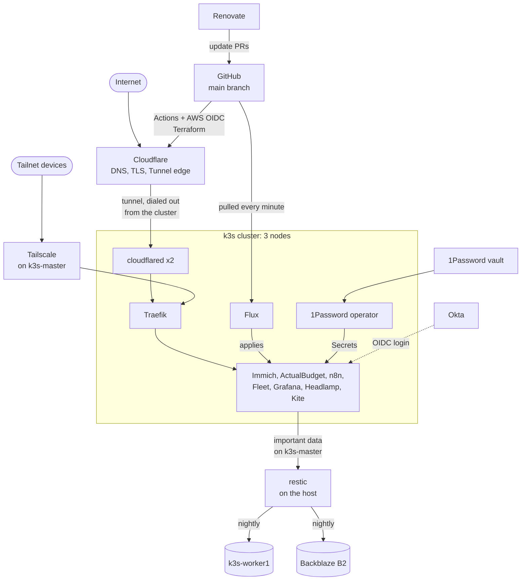

<div align="center">

# homelabops

**A three-node k3s homelab run like a small production platform.**<br/>
GitOps for the cluster, Terraform in CI for the edge, SSO on the admin plane,
and a backup design written after a real outage.

[](https://github.com/yuandrk/homelabops/actions/workflows/terraform-plan.yml)
[](https://github.com/yuandrk/homelabops/actions/workflows/terraform-apply.yml)
[](docs/renovate-config.md)
[](LICENSE)


</div>

## How it fits together



Requests, changes and data each take one path, and the rule for each is written down in
[architecture.md](docs/architecture.md).

## What is interesting here

- **Public without port forwarding, private without a DNS server.** Public apps arrive over
  an outbound-only Cloudflare Tunnel that runs inside the cluster. Tailnet-only apps get `*.home.yuandrk.net`: a DNS-only
  wildcard pointing at a CGNAT Tailscale address, so the name resolves anywhere but connects
  only from the tailnet. That is split-horizon DNS done with two wildcard records.
  [→ network](docs/network-architecture.md)
- **A backup design that came out of an outage.** A Raspberry Pi's USB-SSD hung and took photos
  and the budget down for five days. It held the only copy of the photo library. Now important
  data lives only on the master's NVMe and gets two nightly restic copies, one on the Pi (now a
  tainted, *disposable* node) and one in Backblaze B2. restic runs from the host, so a restore
  never depends on the cluster. [→ backup](docs/backup.md)
- **A sandbox for an AI agent.** Hermes, an LLM agent on the host, works in a namespace with
  default-deny networking, PodSecurity, quotas and a scoped kubeconfig. The namespace also fixes
  a race, found by measurement, in which short-lived Jobs ran unfiltered before kube-router
  programmed their NetworkPolicy. [→ sandbox](docs/hermes-sandbox.md)
- **SSO on the admin plane.** Okta OIDC sits in front of the Kubernetes API (via Headlamp), Kite
  and the agent's dashboard, and each has a written break-glass path. The agent's dashboard
  could only work as a public PKCE client, and the docs say why. [→ access](docs/access.md)
- **Secrets never touch git.** A 1Password vault feeds the 1Password operator, which creates the
  Kubernetes Secrets, with polling tuned to the API's rate limit. [→ secrets](docs/secrets.md)
- **Apps have to earn their place.** Traefik request metrics decide removals: Jellyfin and
  Whisper went after 14 days of zero traffic. [→ usage metrics](docs/usage-metrics.md)
- **Terraform from CI, with no stored cloud keys.** GitHub Actions assumes an AWS role through
  OIDC, plans are commented on PRs, and the merge applies them.
  [→ terraform](docs/terraform-guide.md)
- **Operated with Claude Code, under guardrails.** Rules load into every session. There is a
  read-only Flux diagnostician and a manifest reviewer, hooks warn before direct `kubectl`
  mutations, and the docs are written so an agent never needs private memory to understand a
  decision. [→ tooling](docs/gitops.md#working-with-claude-code)

## Hardware

| | `k3s-master` | `k3s-worker3` | `k3s-worker1` |
|---|---|---|---|
| **Hardware** | i3-7100U, 16 GB, 1 TB NVMe | i5-8265U, 16 GB, 512 GB NVMe, Intel iGPU + NVIDIA MX130 | Raspberry Pi 4, 4 GB, 1 TB USB SSD |
| **Runs** | Control plane, all important data, NFS server, Tailscale router, backups, the Hermes agent | Immich with hardware transcoding, Fleet, PostgreSQL, Prometheus, Loki | DaemonSets and the local backup repository: a *disposable* node |

A wired gigabit LAN for cluster traffic, home Wi-Fi for the internet, and Ubuntu 24.04 throughout.

## Services

| Service | What it does | Reachable from |
|---------|--------------|----------------|
| [Immich](https://immich.app) | Photo and video library | Internet: `photos.yuandrk.net` |
| [ActualBudget](https://actualbudget.org) | Personal budgeting | Internet: `budget.yuandrk.net` |
| [n8n](https://n8n.io) | Workflow automation | Internet: `n8n.yuandrk.net` |
| [Fleet](https://fleetdm.com) | osquery device management | Internet: `fleet.yuandrk.net` |
| [Grafana](https://grafana.com) | Metrics and log dashboards | Internet: `grafana.yuandrk.net` |
| [Headlamp](https://headlamp.dev) | Kubernetes UI, Okta login | Internet: `headlamp.yuandrk.net` |
| [Kite](https://github.com/kite-org/kite) | Kubernetes UI, Okta login | Internet: `kite.yuandrk.net` |
| Hermes dashboard | The AI agent's control panel, a host process behind Traefik | Internet: `hermes.yuandrk.net`, Okta login |
| [qBittorrent](https://www.qbittorrent.org) | Torrent client | Tailnet only: `qbit.home.yuandrk.net` |
| SearXNG, browserless | Search and headless Chromium for the agent | Inside the cluster only |

**Platform:** Flux, Traefik, cloudflared, the 1Password operator, kube-prometheus-stack, Loki and
Alloy in the cluster, with restic and Tailscale on the host.

## Principles

1. The cluster is whatever `main` says. Flux reverts hand edits, and the little it cannot hold is
   [written down](docs/off-git.md).
2. The hostname decides who can reach an app: `*.yuandrk.net` is public, `*.home.yuandrk.net` is
   the tailnet only.
3. Secrets live in 1Password, never in git.
4. Irreplaceable data lives in one place and is copied to two others every night.
5. What must survive a broken cluster runs on the host.
6. An app stays only while it is used.

## Known gaps

Nothing here pretends to be finished:

- **Alerts reach no one yet.** Alertmanager is off, and the custom rules are not loaded
  ([monitoring](docs/monitoring.md#alerting-reaches-no-one)).
- **k3s-master is a single point of failure** for both the control plane and the data. There is
  a [rebuild runbook](docs/runbooks/rebuild-k3s-master.md), but it has not been rehearsed.
- **Infrastructure charts float** on `>=` ranges, so their major upgrades skip review
  ([renovate](docs/renovate-config.md#traps)).
- The rest is in the [backlog](docs/TODO.md).

## Repository layout

```
clusters/prod/          Flux entry point: Kustomizations, Flux itself, 1Password items
apps/                   user-facing apps, one directory per app
infrastructure/         operator, monitoring, cloudflared, Headlamp, Hermes sandbox and dashboard
terraform/live/homelab/ Cloudflare (applied by CI), AWS state bucket and OIDC role, Flux bootstrap
docs/                   architecture, decisions, runbooks, component deep-dives
.claude/                rules, commands, agents and hooks for Claude Code
```

## Documentation

Start with [architecture](docs/architecture.md) and [decisions](docs/decisions.md). Everything
else is indexed in [docs/README.md](docs/README.md), including the runbooks and the
[inventory of everything outside git](docs/off-git.md).

## License

[MIT](LICENSE)
