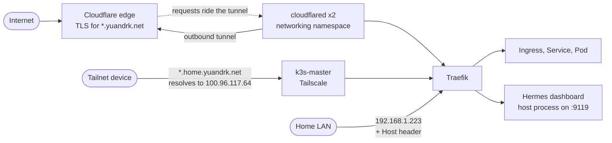
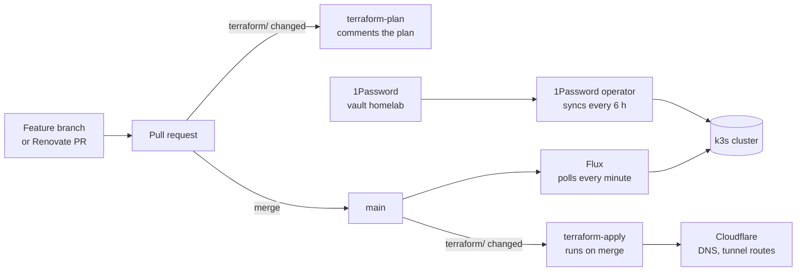
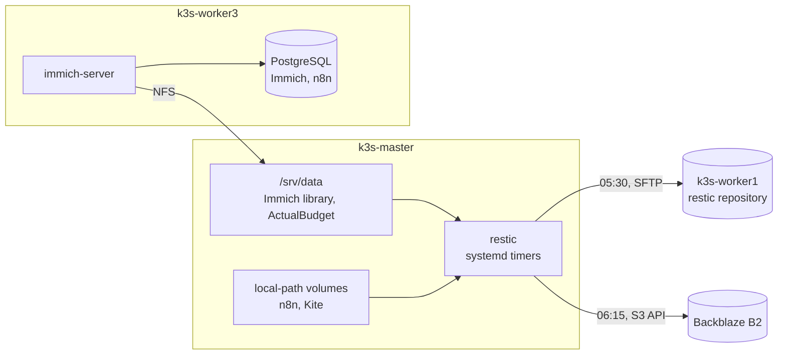

# Architecture

Three nodes, one control plane. Flux applies the cluster from `main`, CI applies the Cloudflare
edge with Terraform, and a few services run on the hosts outside Kubernetes on purpose. This page
holds what stays true from week to week; for what runs right now, ask the cluster
(`flux get all -A`, `kubectl get pods -A -o wide`).

## Principles

1. **The cluster is what `main` says.** Flux applies it and reverts hand edits. The few things
   it cannot hold are listed in [off-git.md](off-git.md).
2. **The hostname decides who can reach an app.** `<app>.yuandrk.net` is public through the
   Cloudflare Tunnel, `<app>.home.yuandrk.net` is tailnet-only. Public traffic arrives over an
   outbound tunnel, so the design needs no port forwarding on the router.
3. **Secrets live in 1Password**, never in git, encrypted or not ([secrets.md](secrets.md)).
4. **Irreplaceable data lives on k3s-master and nowhere else**, and every night it gets two more
   copies: on k3s-worker1 and in Backblaze B2 ([backup.md](backup.md)).
5. **k3s-worker1 is disposable.** It is tainted and runs only DaemonSets and the backup repository.
6. **What must survive a broken cluster runs on the host**: the backups, Tailscale and the
   Hermes agent.
7. **An app stays only while it is used.** It is removed on Traefik request data, not on memory
   ([monitoring.md](monitoring.md#is-an-app-still-used)).
8. **Terraform runs from CI**: plan on the PR, apply on merge to `main`.

## Nodes

| Node | Hardware | Network | Role |
|------|----------|---------|------|
| `k3s-master` | Intel i3-7100U, 16 GB, 1 TB NVMe (Crucial P3) | `10.10.0.1` wired, `192.168.1.223` Wi-Fi, `100.96.117.64` Tailscale | Control plane, important data under `/srv/data`, NFS server, Tailscale subnet router, restic, Hermes |
| `k3s-worker3` | Intel i5-8265U, 16 GB, 512 GB NVMe, Intel UHD 620 + NVIDIA MX130 | `10.10.0.5` wired, `192.168.1.246` Wi-Fi | The heavy worker: Immich compute, Fleet, Prometheus, Loki, the Hermes sandbox. Native PostgreSQL |
| `k3s-worker1` | Raspberry Pi 4, 4 GB, 1 TB USB SSD | `10.10.0.2` wired, `192.168.1.137` Wi-Fi | Disposable: DaemonSets only, plus the local restic repository |

The wired LAN is an unmanaged gigabit switch, and each node reaches the internet over its own
home Wi-Fi link ([network-architecture.md](network-architecture.md)). There is no k3s-worker2: that
Raspberry Pi (`10.10.0.4`) was decommissioned in May 2026.

## What is pinned, and why

Most workloads go wherever the scheduler puts them. Note that a `local-path` volume pins its
pod to the node where the volume was first created. These are pinned on purpose:

| Workload | Node | Why |
|----------|------|-----|
| ActualBudget | k3s-master | Its data is a hostPath under `/srv/data` |
| Immich server, machine learning, Valkey | k3s-worker3 | The server uses the Intel iGPU for hardware transcoding. The library comes over NFS from k3s-master |
| Fleet, its MySQL and Valkey | k3s-worker3 | The Fleet image is amd64-only, and MySQL on `local-path` must not land on the Pi |
| Hermes sandbox jobs and services | k3s-worker3 | The only node with real headroom |
| Prometheus, Grafana, prometheus-operator | amd64 nodes | Memory |
| Everything except DaemonSets | not k3s-worker1 | Taint `homelab.yuandrk.net/disposable=true:NoSchedule` |

## How requests get in

The tunnel forwards to in-cluster Service names, so no node address or NodePort appears in its
config. The `*.home` names resolve anywhere but connect only from the tailnet. The home LAN
reaches any app by IP and `Host` header, so the hostname split controls names and routing, not
permissions ([network-architecture.md](network-architecture.md#split-horizon-without-a-dns-server)).
The Hermes dashboard is the exception to "everything is a pod" ([hermes-dashboard.md](hermes-dashboard.md)).

## How changes get in

Development is trunk-based: there is no `dev` branch and no staging, so a merge to `main` is a
deploy. See [gitops.md](gitops.md), [terraform-guide.md](terraform-guide.md) and
[renovate-config.md](renovate-config.md).

## Where data lives

What the backup leaves out is listed in [backup.md](backup.md#not-in-the-backup).

## Outside the cluster on purpose

| Service | Host | Why not in k3s |
|---------|------|----------------|
| restic | k3s-master | A restore must not depend on a healthy cluster |
| Tailscale | k3s-master | It is the way in when other things are broken |
| Hermes agent and dashboard | k3s-master | The agent's control channel must keep working when the cluster does not |

PostgreSQL on k3s-worker3 is a native install too, for a reason nobody recorded
([TODO](TODO.md#unknowns)).
