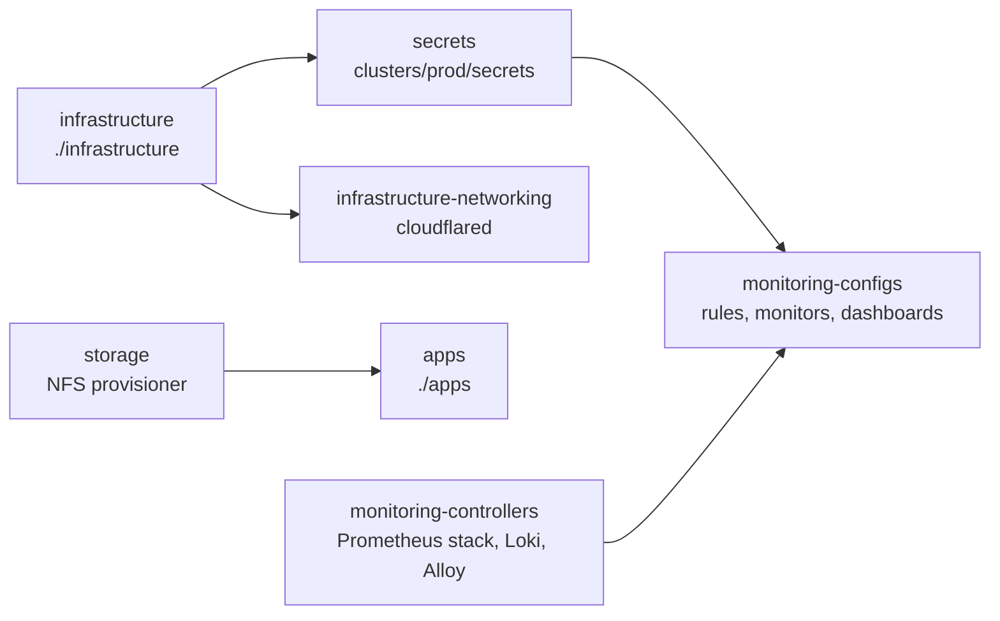

# GitOps

How a change gets from this repository into the cluster, and the traps specific to this repo.

## Layout

```
clusters/prod/            Flux entry point: one file per Flux Kustomization
  flux-system/            Flux itself, written by bootstrap (gotk-components.yaml, gotk-sync.yaml)
  secrets/                OnePasswordItem resources (secrets.md)
apps/<app>/base/          user-facing apps, namespace apps
infrastructure/           1Password operator, Headlamp, monitoring, cloudflared, storage, hermes-*
terraform/live/homelab/   cloudflare/ (applied by CI); aws-bootstrap/, aws-oidc/, fluxcd/ (applied once by hand)
.claude/                  rules, commands, agents and hooks for Claude Code
```

## Flux Kustomizations

Flux pulls `main` from the GitRepository `flux-system` every minute. The root Kustomization
(`flux-system`, path `clusters/prod`) creates the seven below. The arrows are `dependsOn`:



- `secrets` waits for `infrastructure` because the operator and its CRD come from there.
- `apps` waits only for `storage`, not for `secrets`. A first deploy can show a short
  `CreateContainerConfigError` until the app's Secret has been synced.
- Intervals are 10 minutes for most, and 1 hour for the two monitoring Kustomizations. A hand
  edit lasts until the next run. To keep one while debugging, use
  `flux suspend kustomization <name> -n flux-system`.

## Adding an app

1. Scaffold it with `/new-app <name> [port] [storageGi]` (Claude Code), which copies the n8n
   pattern into `apps/<name>/base/` and registers it in `apps/kustomization.yaml`.
2. Choose who can reach it by its hostname. For a public app, use `<name>.yuandrk.net` and add
   an entry to `local.tunnel_services` in `terraform/live/homelab/cloudflare/main.tf`. For a
   tailnet-only app, use `<name>.home.yuandrk.net`, with no Terraform change. Do not use a
   NodePort.
3. Put secrets in 1Password and add an `OnePasswordItem` ([secrets.md](secrets.md#adding-a-secret)).
4. Decide where its data lives. If losing it would hurt, pin the app to k3s-master and keep the
   data under `/srv/data`. Only k3s-master is backed up, and a `local-path` volume stays on
   whichever node it was first created on.
5. Update the docs that list apps: the Services table in `README.md` and
   `.claude/rules/services.md`.
6. Open a PR, merge it, then `/reconcile apps`.

## Upgrading

Renovate opens grouped PRs every Monday ([renovate-config.md](renovate-config.md)). For a
targeted upgrade, use `/upgrade-app <app> <version>`. For Helm charts that run several
components, set the image tag per component, not at the top level.

## Removing an app

Check its traffic first ([usage-metrics.md](usage-metrics.md)). Then, in one commit where
possible:

- [ ] `apps/<app>/` and its line in `apps/kustomization.yaml`
- [ ] its `OnePasswordItem` and its line in `clusters/prod/secrets/kustomization.yaml`, in the
      **same** commit ([why](secrets.md#removing-a-secret))
- [ ] its entry in `local.tunnel_services`, if it was public
- [ ] the Services table in `README.md`, `.claude/rules/services.md`, and a line in the
      removal log in [decisions.md](decisions.md#removed-apps)

After the merge, Flux prunes the Deployment, Service, Ingress and PVCs. These you clean up by hand:

- [ ] hostPath data on disk (delete it, or keep it on purpose and say so in the removal log)
- [ ] the 1Password item

## Traps in this repo

- **An empty or commented-out `kustomization.yaml` breaks the whole Kustomization**, not just
  that app. Remove the directory and its reference instead.
- **Heavy Helm installs can outlive the default 5-minute timeout.** Set `spec.timeout` on the
  HelmRelease. The pods may be healthy while the release reports a failure.
- **Two Kustomizations apply the monitoring stack.** `infrastructure` includes
  `infrastructure/monitoring/base`, which pulls in the kube-prometheus-stack HelmRelease and
  everything under `configs/`. `monitoring-controllers` and `monitoring-configs` apply the same
  objects. The `dependsOn` of `monitoring-configs` therefore does not gate them, and the Flux
  ownership labels flip between the two. Untangle it carefully: dropping the path from one side
  makes that side prune what it believes it owns.
- **The Flux webhook may be a dead end.** No `Receiver` exists in git ([off-git.md](off-git.md#open-questions)).
  The 1-minute poll is what actually picks up merges.
- **The NFS provisioner is scaled to zero but still wired in.** `apps` depends on `storage`,
  whose health check is that provisioner's Deployment. Removing it means editing
  `clusters/prod/storage.yaml` and `apps.yaml` together.

## Everyday commands

```bash
flux get kustomizations -A
flux get helmreleases -A
flux reconcile source git flux-system -n flux-system
flux reconcile kustomization apps -n flux-system
flux events --for Kustomization/apps -n flux-system
kubectl get pods -A --field-selector=status.phase!=Running
```

## Working with Claude Code

`.claude/` makes the repository operable by Claude Code without handing it the keys:

- **Rules** (`.claude/rules/`) load into every session: services and naming, the deploy
  workflow, Flux CLI usage, Terraform, monitoring, and how to keep these docs honest.
- **Commands**: `/cluster-status` (read-only health snapshot), `/reconcile`, `/new-app`,
  `/upgrade-app`.
- **Agents**: `flux-doctor` diagnoses a failing reconcile without changing the cluster.
  `manifest-reviewer` checks rendered manifests before a commit.
- **Hooks** warn before a local `kubectl apply/delete/edit/patch/replace/scale` or `terraform apply`,
  since those bypass GitOps, and before committing key material.
